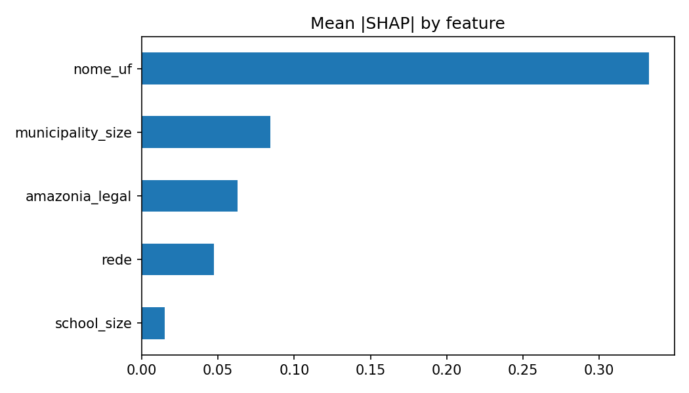
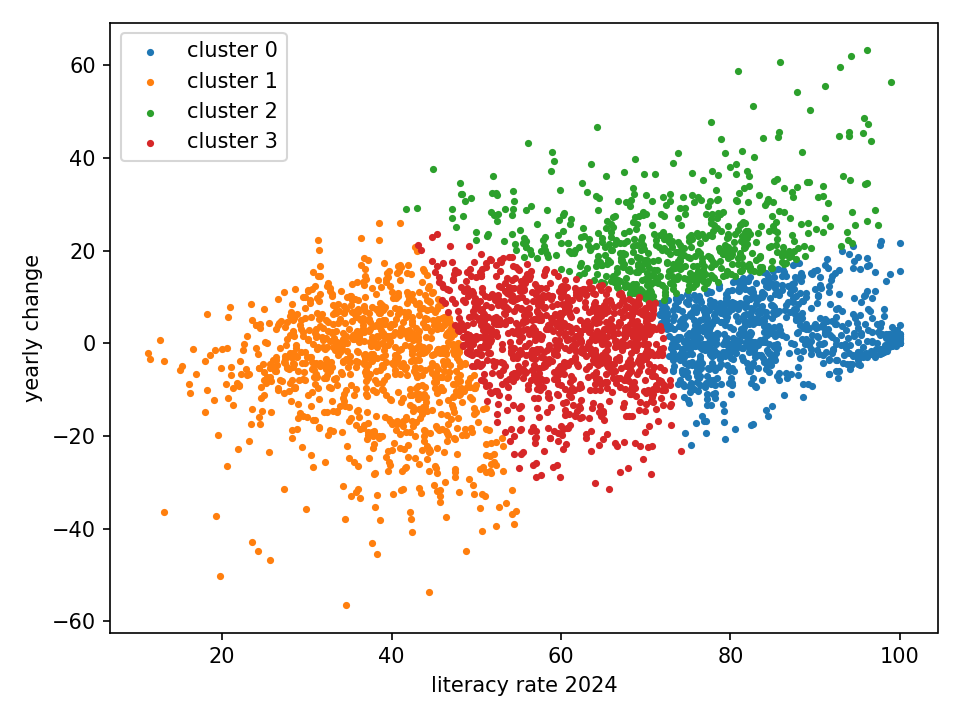

# Tech Challenge - Fase 3
## Predição e Inteligência Analítica para Alfabetização no Brasil

Nesta fase usamos a camada Gold construída na Fase 2 para treinar um modelo que prevê se um aluno do 2º ano é alfabetizado ou não, e para analisar quais municípios e regiões estão mais longe da meta de 2030.

## 1. Contexto do problema

O Compromisso Nacional Criança Alfabetizada tem a meta de que todas as crianças estejam alfabetizadas até o fim do 2º ano do ensino fundamental, até 2030. O INEP definiu que uma criança é considerada alfabetizada quando atinge 743 pontos na escala de proficiência do Saeb.

Saber o número atual não basta para decidir onde agir. Quem gere a política pública precisa saber onde o problema é maior, quais fatores pesam mais e quais municípios provavelmente não vão chegar na meta se nada mudar.

## 2. Objetivo analítico

- Treinar um modelo supervisionado que preveja se o aluno é alfabetizado
- Descobrir quais fatores mais pesam na predição
- Identificar municípios com maior risco de não atingir a meta
- Agrupar municípios com padrões parecidos
- Registrar o que o modelo consegue e o que não consegue dizer

## 3. Descrição da base

A base de modelagem é a tabela `gold.base_modelagem_alunos`, criada a partir da silver da Fase 2 (microdados de alunos da Base dos Dados, com o diretório de municípios do IBGE).

- 3.354.637 alunos do 2º ano, em 2023 e 2024
- 5.547 municípios e 42.802 escolas
- 59% dos alunos são alfabetizados (variável alvo `alfabetizado`)
- Redes Municipal e Estadual (a rede Privada tinha só 24 alunos e foi removida)

Colunas usadas: rede, estado, se o município está na Amazônia Legal, tamanho da escola e tamanho do município (número de alunos avaliados). Também testamos a taxa do município no ano anterior e a população do município (IBGE, via Base dos Dados).

Decisões sobre o alvo, que são as mais importantes do projeto:

- O alvo `alfabetizado` é exatamente `proficiencia >= 743`, sem nenhuma exceção. Por isso a nota (`proficiencia`) ficou fora das variáveis: o modelo acertaria tudo sem aprender nada útil (data leakage).
- 513.338 alunos (13,3%) não preencheram o caderno e estavam marcados como não alfabetizados. Eles não fizeram a prova, então ficaram fora do treino. Se entrassem, o modelo aprenderia a regra "não fez a prova = 0", que não tem a ver com alfabetização.
- `presenca` e `preenchimento_caderno` também saíram, pelo mesmo motivo.

## 4. Etapas de modelagem

**Análise exploratória.** Cada consulta testou uma hipótese:

- Território pesa muito: Ceará tem 85,0% de alfabetizados e Sergipe 34,8%. Por região, Sul 64,5%, Centro-Oeste 62,0%, Sudeste 61,3%, Nordeste 55,8% e Norte 50,9%.
- A Amazônia Legal fica atrás: 53,5% contra 60,3% fora dela.
- A rede pesa pouco: Estadual 62,1% e Municipal 58,8%.
- O caderno da prova não importa: as 20 versões ficam entre 58,7% e 59,9%. A hipótese de que a dificuldade da prova explicaria a diferença foi descartada.
- A série é a mesma para todos (2º ano), então não serve como variável.
- A taxa do município no ano anterior tem correlação de 0,25 com o resultado do aluno em 2024.

**Pipeline (scikit-learn).** Todo o pré-processamento está dentro do `Pipeline`, então é ajustado só com os dados de treino de cada divisão:

- Variáveis numéricas: imputação pela mediana, `log1p` e padronização
- Variáveis categóricas: imputação pelo valor mais frequente e one-hot encoding (categorias novas são ignoradas)

**Validação e controle de leakage.**

- Os dados são divididos por município. Todos os alunos de um município ficam do mesmo lado, senão o modelo veria no treino alunos da mesma cidade do teste e as métricas ficariam infladas.
- 80% dos municípios para treino e validação cruzada (5 divisões agrupadas), 20% separados para o teste final, que só foi usado no fim.
- A taxa do município vem sempre do ano anterior, porque a taxa do mesmo ano é calculada com os próprios alunos do treino.
- Por limite de memória do ambiente, usamos uma amostra de 15% dos alunos (cerca de 503 mil), com semente fixa (42).

**Experimentos.**

- Modelo A: aluno, território e tamanhos. AUC de validação 0,630.
- Modelo B: A mais a taxa do município no ano anterior (só 2024). AUC 0,650 na regressão logística e 0,654 no boosting. A comparação não é perfeita porque o B usa menos dados.
- Modelo C: A mais população do município. AUC 0,630 (logística) e 0,628 (boosting). Sem ganho.

**Otimização.** Testamos 4 valores de regularização (`C`) na regressão logística e 8 combinações de parâmetros no gradient boosting, com validação agrupada. O melhor `C` foi 1, o valor que já usávamos. O boosting ajustado chegou a 0,627 de AUC no teste, um ganho de 0,002 que não justifica o modelo mais complexo.

## 5. Escolha do algoritmo

Regressão logística. Ela teve o mesmo desempenho do gradient boosting na validação, é mais simples de explicar, e quase não mostra diferença entre treino e validação (0,635 contra 0,628), ou seja, não decorou os dados. O boosting decorou um pouco mais o treino sem melhorar a validação.

## 6. Métricas de avaliação

Usamos AUC como métrica principal, porque a classe alfabetizado é maioria (59%) e a acurácia sozinha engana. Também olhamos F1, recall e precisão da classe não alfabetizado, que é a que importa para política pública.

Resultado no teste final, com municípios que o modelo nunca viu:

- AUC: 0,625
- Acurácia: 0,614 (prever sempre "alfabetizado" dá 0,599)
- Com corte de 0,5, o modelo acerta 89% dos alfabetizados, mas só 20% dos não alfabetizados
- Com corte de 0,6, escolhido nos dados de treino: acerta 61% dos não alfabetizados (precisão de 48%) e a acurácia balanceada fica em 0,588

Escolhemos o corte de 0,6 porque deixar passar um aluno que precisa de ajuda custa mais do que apontar um aluno a mais. O preço é uma acurácia total menor (0,58).

## 7. Interpretação dos resultados

Importância por permutação (queda de AUC ao embaralhar a variável) e SHAP concordam na ordem:

- Estado: de longe a mais importante (queda de 0,114 no AUC)
- Tamanho do município: 0,011
- Amazônia Legal: 0,007
- Rede: 0,003
- Tamanho da escola: praticamente zero

O estado já contém boa parte da informação da Amazônia Legal, então o peso dela pode estar parcialmente escondido dentro do estado.

## 8. Insights

- O território explica muito mais do que as características da escola ou da rede. O estado onde o aluno estuda importa mais do que qualquer outra variável que testamos.
- Tamanho da escola, população do município e versão do caderno não ajudam a prever alfabetização.
- O histórico do município ajuda um pouco (AUC de 0,630 para 0,650).
- Risco por município: consideramos 3.392 municípios da rede municipal com pelo menos 50 alunos avaliados nos dois anos e meta definida. Projetando a variação de 2023 para 2024 até 2030, cerca de 49,6% não atingiriam a meta. Isso varia muito por região: Sul 70,6%, Norte 57,1%, Nordeste 54,5% e Sudeste 26,4%.
- Os 15 municípios mais distantes da meta têm taxas entre 11% e 18% e quase todos ficam no Norte e Nordeste: Bahia (6), Sergipe (4), Tocantins (3) e Amazonas (1). A exceção é Taquari, no Rio Grande do Sul.
- Agrupamos esses municípios em 4 perfis (resultados na tabela `gold.risco_municipios`):
  - Grupo 0, já bons (832 municípios): cerca de 84% e acima da meta
  - Grupo 1, críticos e piorando (949): cerca de 38% e caindo 6 pontos por ano
  - Grupo 2, em forte alta (593): subiram em média 23 pontos
  - Grupo 3, estagnados no meio (1.018): cerca de 60%, sem mudança
- Cerca de 44% dos municípios do Norte e do Nordeste estão no grupo crítico, contra 4% no Sudeste.

## 9. Limitações

- O modelo é fraco para prever o aluno individual: AUC de 0,63, e com corte de 0,6 ele ainda erra mais da metade dos alertas. Serve para priorizar territórios, não para decidir sobre um aluno.
- Os alunos do mesmo estado e rede têm quase as mesmas variáveis, então o modelo não consegue separá-los. Faltam dados do aluno, da família e da escola (infraestrutura, professores, nível socioeconômico).
- Só existem dois anos (2023 e 2024). A variável do ano anterior só existe para 2024.
- A projeção de risco usa só dois pontos no tempo e assume que a variação continua igual por seis anos. Ela exagera quando o resultado oscila, como no Sul, onde a média caiu de 2023 para 2024. O ranking pelas distâncias atuais é mais estável.
- Municípios pequenos têm taxas instáveis. Por isso exigimos 50 alunos por ano, o que deixou de fora vários municípios.
- Os alunos que não fizeram a prova (13%) ficaram de fora. Se eles tiverem um perfil diferente, as taxas aqui ficam acima das oficiais, que contam todos os matriculados.
- As taxas não usam o peso amostral do Saeb (`peso_aluno`), então não são comparáveis com os números oficiais do MEC.
- Treinamos com uma amostra de 15% por limite de memória.
- As variáveis do município (tamanho, população) valem igual para todos os alunos dele.

## 10. Aplicação prática para políticas públicas

- Usar a lista de municípios mais distantes da meta e o grupo crítico para priorizar apoio técnico e recursos, em vez de distribuir igual.
- Tratar cada grupo de forma diferente: manter o que funciona nos grupos bons, investigar o que mudou no grupo em alta (pode virar prática para replicar) e olhar com atenção o grupo crítico e o estagnado.
- Acompanhar a cada ano quem sai ou entra do grupo crítico, como alerta antecipado.
- Usar o modelo só em nível de território. Ele não deve ser usado para decidir sobre um aluno.

## 11. Possíveis evoluções futuras

- Incluir dados de infraestrutura e perfil das escolas (Censo Escolar), nível socioeconômico (Atlas do Desenvolvimento Humano, Cadastro Único) e financiamento (FUNDEB)
- Usar mais anos do Saeb para validar no tempo (treinar em anos antigos e testar nos mais novos) e melhorar a projeção
- Testar modelos que considerem a estrutura em níveis (aluno, escola, município)
- Usar a localização (latitude e longitude do município) para capturar vizinhança
- Calibrar as probabilidades e usar o peso amostral nas métricas
